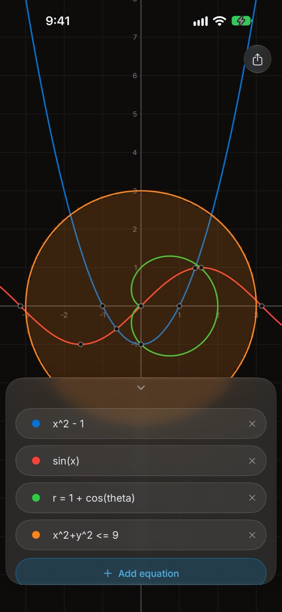
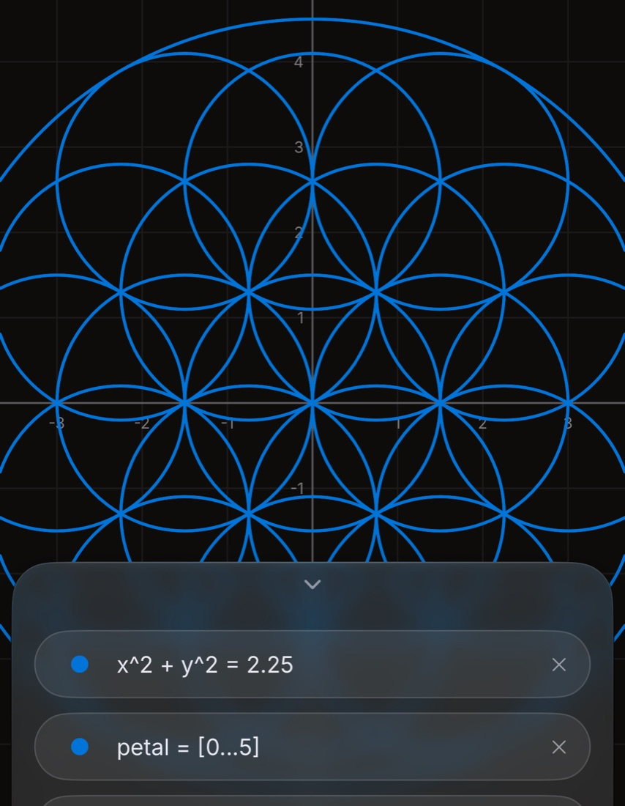
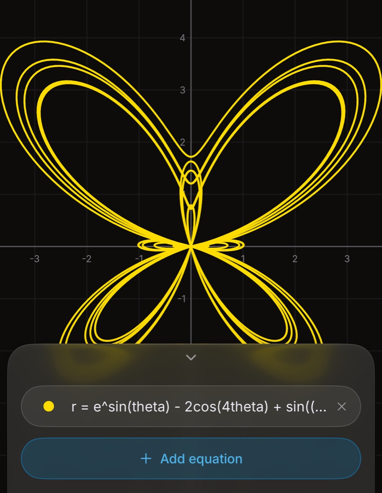
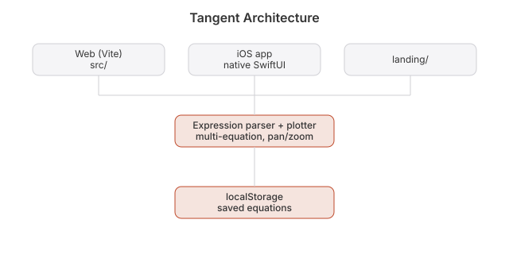

 [](https://github.com/nulljosh/curvely/actions/workflows/test.yml)  [](https://apps.apple.com/us/app/curvely/id6794988370)

**Live:** https://curvely.jaybulb.com

A graphing calculator that feels like it belongs on your phone. Type an equation and watch it draw. Native SwiftUI on iPhone, iPad and Mac, and the same app on the web. Everything runs on your device.

<p>



</p>

## Features

- Curves `x^2`, implicit equations `x^2 + y^2 = 4`, points `(1, 2)`, parametric `(cos(t), sin(t))` and polar `r = 1 + cos(theta)`.
- Inequalities shade their region: `y > x^2`.
- Sliders: type `a = 3`, or `a = 3 {0 < a < 10}` for a range, and press play to sweep it.
- Your own functions `f(x) = x^2`, derivatives `f'(x)` and `d/dx(sin(x))`, piecewise `{x < 0: -x, x}` and domain limits `sin(x) {0 < x < 5}`.
- Lists: `L = [1...10]`, then `(L, L^2)` or `sin(x) + [0, 1, 2]` draws one copy per element.
- Roots, peaks and crossings show as dots. Hover or tap one to read it.
- 85 patterns in one tap: the flower of life, a sunflower, the golden spiral, a butterfly, roses, spirographs and more.
- Light and dark, Liquid Glass panels, and Curvely Sans, a renamed Inter whose quote marks are drawn as waves.

## Run it

```bash
npm install && npm run dev     # web app on port 5174
npm test                       # web tests
cd ios && xcodegen generate    # then open Grapher.xcodeproj for iPhone, iPad and Mac
```

A terminal sparkline lives in [tui/](tui/): `swift build && ./.build/debug/curvely-tui "x^2" -5 5`.

## API and agent tools

An agent can drive this app. [`docs/API.md`](docs/API.md) lists the HTTP API and the WebMCP tools.

## More

[Whitepaper](WHITEPAPER.md) · [Roadmap](roadmap.md) · [Changelog](CHANGELOG.md) · [Security](SECURITY.md)



MIT 2026, Joshua Trommel
